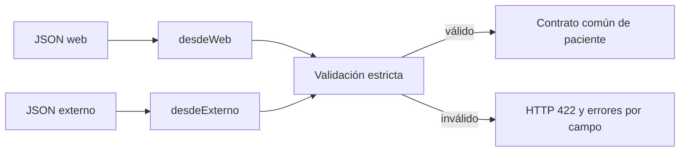

# Tema 2.3: traducción y normalización de pacientes

- **Estudiante:** Vera Mero Jereny Jhonnayker
- **GitHub:** `jerenyvera09`
- **Asignatura:** Integración e Implementación de Software
- **Práctica:** Tema 2.3 – Patrones de traducción y normalización

El módulo `PracticaNormalizacionHache` es el desarrollo individual del estudiante, realizado en la rama independiente `practica-normalizacion`.

## Mapeo al contrato del backend

| Formulario web | Servicio externo | Contrato común | Regla |
|---|---|---|---|
| `nombreCompleto` | `full_name` | `nombres` | Texto, recorte y espacios repetidos a uno; obligatorio; máximo 255 caracteres. |
| `numeroCedula` | `document_number` | `cedula` | Texto sin espacios internos; obligatorio; máximo 20 caracteres. |
| `telefono` | `phone` | `telefono` | Texto sin espacios internos; opcional; máximo 20 caracteres. |
| `direccion` | `address` | `direccion` | Texto, recorte y espacios repetidos a uno; opcional; máximo 255 caracteres. |
| `fechaNacimiento` | `birth_date` | `fecha_nacimiento` | Web: `dd/mm/aaaa`; externo: `aaaa-mm-dd`; salida ISO; fecha real y no futura; opcional. |

Los campos opcionales ausentes se devuelven como `null`, de acuerdo con `StorePacienteRequest`. Los identificadores numéricos, formatos de fecha distintos y claves ajenas al origen generan HTTP 422 con un error por campo. No se comprueba unicidad de cédula porque eso requeriría consultar la base de datos; esta práctica solo traduce y valida la estructura.



## Ejecución local

Desde `backend-api`:

```powershell
Copy-Item .env.testing.example .env.testing
php artisan key:generate --env=testing
php artisan test tests/Feature/PracticaNormalizacionHacheTest.php --display-warnings
php artisan route:list --path=practica-normalizacion-hache
```

Prepara `.env.testing` una sola vez a partir de la plantilla. `key:generate` crea una clave local para las pruebas; la plantilla no incluye ninguna clave activa. `.env.testing` está excluido de Git y SQLite funciona en memoria, sin base de datos externa.

Las rutas de demostración son `POST /api/practica-normalizacion-hache/web` y `POST /api/practica-normalizacion-hache/externo`. Aceptan los JSON del enunciado y devuelven directamente los cinco campos del contrato común. Solo ejecutan el traductor; no llaman al registro de pacientes ni escriben en la base de datos.

## Resultados comprobados

El 15/11/2026 se ejecutó `php artisan test tests/Feature/PracticaNormalizacionHacheTest.php --display-warnings`: 8 pruebas aprobadas, 26 aserciones, sin fallos ni advertencias. P1 y P2 devolvieron HTTP 200 y exactamente el mismo JSON esperado. P3 devolvió HTTP 422 tanto por `numeroCedula` ausente como por `fechaNacimiento` inválida. También se verificaron fecha futura, formato ambiguo, tipos numéricos, longitud excesiva, campos opcionales ausentes y claves ajenas al origen. Las expresiones regulares `/\s+/u` y `/\s/u` se comprobaron directamente con PHP: normalizaron los espacios y detectaron espacios internos sin error de PCRE.

Antes de añadir `.env.testing`, PHPUnit mostró 8 advertencias porque esta copia no tiene `.env`. La configuración local de pruebas eliminó esas advertencias. Después se ejecutó `php artisan test --compact`: 158 pruebas aprobadas, 23 omitidas y 7 fallidas (1174 aserciones). Cinco fallos requieren la extensión PHP GD para generar imágenes simuladas; dos fallos de `AuditoriaTransaccionesTest` ocurren porque su esquema SQLite en memoria omite la migración que agrega `agenda.nombre_reserva`. El fallo previo por `APP_KEY` ausente quedó resuelto por la clave de prueba. Estas causas pertenecen a otras pruebas y módulos; para resolverlas se necesitaría habilitar GD y actualizar el esquema aislado de `AuditoriaTransaccionesTest`, sin intervenir en esta práctica.

## Reflexión individual

Separar la traducción por origen permite aceptar nombres y formatos distintos sin alterar el contrato clínico. Validar antes de devolver los datos evita pérdidas silenciosas, especialmente en cédulas y teléfonos con ceros iniciales y fechas ambiguas. La ruta aislada demuestra la integración en Laravel sin crear pacientes reales.
