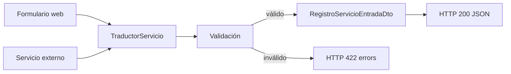

# Práctica 2.3 — Normalización de servicios odontológicos

El módulo `app/Academic/NormalizacionServicios` traduce dos fuentes simuladas al contrato de `RegistroServicioEntradaDto`. No autentica, consulta categorías, registra servicios ni usa base de datos. Las rutas están destinadas a la demostración académica.

## Tabla de mapeo

| Contrato común | Formulario web | Servicio externo | Regla |
| --- | --- | --- | --- |
| `categoria_id` | `categoriaId` | `category_uuid` | Texto UUID, obligatorio; recorta espacios. |
| `nombre` | `nombreServicio` | `service_name` | Texto obligatorio; recorta espacios. |
| `descripcion` | `detalle` | `description` | Texto obligatorio; recorta espacios. |
| `imagen` | `imagenUrl` | `image_url` | Texto opcional; vacío o ausente → `null`. |
| `precio` | `precioTexto` | `amount` | Número no negativo; admite decimal con coma o punto; vacío o ausente → `null`. |
| `duracion_minutos` | `duracionMinutos` | `duration_minutes` | Entero positivo; acepta dígitos textuales; vacío o ausente → `null`. |

Los campos desconocidos se rechazan. Los errores tienen HTTP 422 y un objeto `errors` con mensajes por campo del contrato; para una clave desconocida, se usa su nombre original. Varios errores se informan juntos. `categoria_id` conserva el UUID textual y no se comprueba su existencia en la base. El precio se serializa como número JSON, sin fijar dos decimales; la duración se serializa como entero.

## Ejemplos

Formulario web, `POST /api/practica-normalizacion-servicios/formulario-web`:

```json
{"categoriaId":" 123e4567-e89b-42d3-a456-426614174000 ","nombreServicio":" Limpieza dental ","detalle":" Profilaxis ","imagenUrl":" servicios/limpieza.png ","precioTexto":" 35,50 ","duracionMinutos":" 45 "}
```

Servicio externo, `POST /api/practica-normalizacion-servicios/servicio-externo`:

```json
{"category_uuid":"123e4567-e89b-42d3-a456-426614174000","service_name":"Limpieza dental","description":"Profilaxis","image_url":"servicios/limpieza.png","amount":"35.50","duration_minutes":45}
```

Ambos devuelven HTTP 200 y exactamente:

```json
{"categoria_id":"123e4567-e89b-42d3-a456-426614174000","nombre":"Limpieza dental","descripcion":"Profilaxis","imagen":"servicios/limpieza.png","precio":35.5,"duracion_minutos":45}
```

Ejemplo inválido: `{"categoriaId":"no-uuid","nombreServicio":" ","detalle":" "}` devuelve HTTP 422 con `errors.categoria_id`, `errors.nombre` y `errors.descripcion`.



## Ejecución y resultados

Desde `backend-api`:

```powershell
php artisan test --filter=NormalizacionServiciosTest --compact
php artisan test --filter=RegistroServicioContratoTest --compact
```

Ejecución local final, con `.env` vacío y temporal retirado al terminar: **9 pruebas aprobadas, 50 aserciones, sin fallos ni advertencias**. Normalización: 6 pruebas y 26 aserciones. Contrato anterior: 3 pruebas y 24 aserciones. La ejecución inicial sin `.env` produjo advertencias de lectura de ese archivo; no fueron fallos de prueba. La prueba anterior utiliza SQLite **en memoria**; las seis nuevas no preparan ni consultan una base de datos. Los DTO anteriores no se modificaron.
