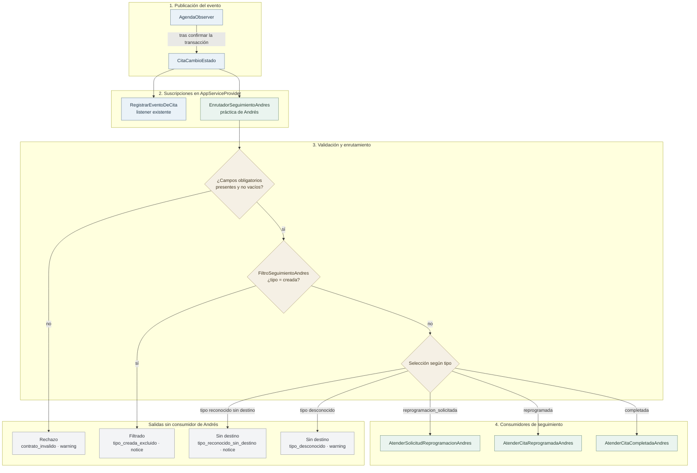

# Práctica 3.2 — Enrutamiento de seguimiento de citas (Andrés García)

Se reutiliza `CitaCambioEstado`, publicado por `AgendaObserver` después de confirmar cambios de citas. El router `EnrutadorSeguimientoAndres` se registra como una suscripción adicional en `AppServiceProvider`. Los demás listeners que existan en la rama continúan independientes.

## Contrato y reglas

Los campos obligatorios son `evento_id`, `tipo`, `cita_id`, `paciente_id`, `estado`, `instancia` y `ocurrido_en`, todos como texto no vacío. `paciente_nombre`, `fecha` y `hora_inicio` pueden ser nulos. Se enruta por `tipo` y no por prioridad, porque este contrato no incluye prioridad.

| Condición | Destino o resultado | Motivo |
|---|---|---|
| `reprogramacion_solicitada` con contrato válido | `AtenderSolicitudReprogramacionAndres` | Solicitud de cambio de horario |
| `reprogramada` con contrato válido | `AtenderCitaReprogramadaAndres` | Cambio de cita realizado |
| `completada` con contrato válido | `AtenderCitaCompletadaAndres` | Cita finalizada |
| `creada` con contrato válido | Sin consumidor; filtrado | Evita tratamiento adicional de altas genéricas en este flujo de seguimiento |
| Tipo reconocido sin destino | `no_enrutables` (`notice`) | Tipo válido que no integra los tres destinos de esta práctica |
| Tipo desconocido | `no_enrutables` (`warning`) | Tipo ajeno al contrato |
| Falta un campo obligatorio | Rechazo `contrato_invalido` (`warning`) | Validación previa al filtro |

Los consumidores son clases Laravel locales que registran `evento_id` y `cita_id`. No actualizan citas, no emiten notificaciones y no simulan una entrega por broker real. La demostración local publica los cinco eventos tipados mediante el despachador real de Laravel y captura sus trazas en memoria. En `sin_cita_id` entrega el arreglo incompleto directamente al router, ya que el evento tipado siempre contiene ese campo. El listener de bitácora existente queda en una cola falsa durante la demostración, sin escribir archivos ni consultar la base de datos.

## Flujo de mensajes



## Seis casos obligatorios para capturas

Situarse en `backend-api` y ejecutar cada comando por separado:

```powershell
php .\tests\demo_enrutamiento_andres.php reprogramacion_solicitada
php .\tests\demo_enrutamiento_andres.php reprogramada
php .\tests\demo_enrutamiento_andres.php completada
php .\tests\demo_enrutamiento_andres.php desconocido
php .\tests\demo_enrutamiento_andres.php creada
php .\tests\demo_enrutamiento_andres.php sin_cita_id
```

Cada comando imprime JSON de entrada, validación, filtrado, consumidor o motivo, traza capturada y `verificacion: correcta` si el comportamiento coincide con la regla. Todos los identificadores de prueba son ficticios.

Pruebas automatizadas y regresión:

```powershell
php artisan test --filter=EnrutamientoAndresTest --display-warnings
php artisan test --filter=EventosCitaTest --display-warnings
```

No se deben afirmar resultados aprobados hasta ejecutar los comandos en el equipo. Las pruebas usan el entorno de pruebas Laravel configurado en `phpunit.xml`; no ejecutar migraciones sobre bases de datos compartidas.
