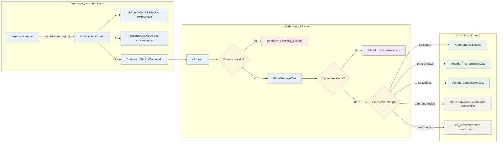

# Práctica Individual 3.2: Content-Based Router y Message Filter

## Arquitectura

`AgendaObserver` publica `CitaCambioEstado` después del commit cuando cambia una cita de paciente de forma relevante. `AppServiceProvider` registra tres suscripciones independientes al evento:

| Suscripción | Función |
| --- | --- |
| `DifundirCambioDeCita` | Difunde por WebSocket. |
| `RegistrarEventoDeCita` | Registra la bitácora mediante la cola `eventos`. |
| `EnrutadorCitaPorContenido` | Valida, filtra y dirige el mensaje según `tipo`. |

El filtro solo afecta a la tercera suscripción. Los otros dos listeners siguen recibiendo los eventos. Los tres destinos nuevos son clases consumidoras de Laravel dentro del backend; no se añade un broker. Cada una registra `evento_id` y `cita_id`, sin modificar citas ni emitir notificaciones.

### Contrato de entrada

El router recibe `CitaCambioEstado` en `handle()` y convierte el evento con `aArreglo()`. `enrutar(array $mensaje)` exige `evento_id`, `tipo`, `cita_id`, `paciente_id`, `estado`, `instancia` y `ocurrido_en` como cadenas no vacías. `paciente_nombre`, `fecha` y `hora_inicio` pueden ser nulos. La validación precede a `FiltroMensajeCita` y a la selección de destino.

## Flujo real



## Reglas de decisión

| Condición | Tipo de mensaje | Destino | Resultado | Justificación |
| --- | --- | --- | --- | --- |
| Falta un campo obligatorio, no es cadena o está vacío | Cualquiera, incluso `actualizada` | Ningún consumidor; no se ejecuta el filtro | `warning`: `enrutamiento_cita.rechazado`, motivo `contrato_invalido`, lista `campos` | El contrato se valida antes de aplicar la regla de negocio. |
| Contrato válido; coincide con el filtro | `actualizada` | Ningún consumidor | `notice`: `enrutamiento_cita.filtrado`, motivo `tipo_actualizada` | La actualización genérica queda excluida expresamente. |
| Contrato válido; pasa el filtro | `solicitada` | `AtenderSolicitudCita` | `info`: `enrutamiento_cita.solicitada` | Se registra la atención de solicitudes. |
| Contrato válido; pasa el filtro | `programada` | `AtenderProgramacionCita` | `info`: `enrutamiento_cita.programada` | Se registra la atención de programaciones. |
| Contrato válido; pasa el filtro | `cancelada` | `AtenderCancelacionCita` | `info`: `enrutamiento_cita.cancelada` | Se registra la atención de cancelaciones. |
| Contrato válido; tipo conocido sin destino | `creada`, `reprogramacion_solicitada`, `reprogramada`, `completada` | Ningún consumidor | `notice`: `enrutamiento_cita.no_enrutables`, motivo `tipo_reconocido_sin_destino` | Los otros tipos del contrato actual conservan un resultado observable. |
| Contrato válido; tipo fuera de `CitaCambioEstado::TIPOS` | Desconocido | Ningún consumidor | `warning`: `enrutamiento_cita.no_enrutables`, motivo `tipo_desconocido` | Se registra el tipo que no pertenece al contrato conocido. |

## Evidencias y reproducción

### Seis casos obligatorios

`tests/demo_enrutamiento_cita.php` ejecuta el router, el filtro y los consumidores Laravel reales en un proceso local. No despacha el evento al bus, no abre un endpoint ni consulta la base de datos. Captura el registro en memoria y entrega un JSON con `entrada`, `tipo`, `validacion`, `filtro`, `consumidor`, `motivo_rechazo`, `trazas` y `verificacion`. Usa identificadores y nombre ficticios. Si la traza no coincide con la esperada, termina con código 1.

Desde la raíz del proyecto, ejecutar por separado en PowerShell para capturar cada salida JSON completa:

```powershell
Set-Location .\backend-api
php .\tests\demo_enrutamiento_cita.php solicitada
php .\tests\demo_enrutamiento_cita.php programada
php .\tests\demo_enrutamiento_cita.php cancelada
php .\tests\demo_enrutamiento_cita.php desconocido
php .\tests\demo_enrutamiento_cita.php actualizada
php .\tests\demo_enrutamiento_cita.php sin_cita_id
```

La entrada contiene `evento_id`, `tipo`, `cita_id`, `paciente_id`, `paciente_nombre`, `estado`, `fecha`, `hora_inicio`, `instancia` y `ocurrido_en`. En `sin_cita_id`, el tipo es `actualizada` y se elimina `cita_id` para demostrar que la validación ocurre antes del filtro.

| Caso | Validación | Filtro | Consumidor o motivo | Registro observado |
| --- | --- | --- | --- | --- |
| `solicitada` | Aprobada | Permitido | `AtenderSolicitudCita` | `info`: `enrutamiento_cita.solicitada` |
| `programada` | Aprobada | Permitido | `AtenderProgramacionCita` | `info`: `enrutamiento_cita.programada` |
| `cancelada` | Aprobada | Permitido | `AtenderCancelacionCita` | `info`: `enrutamiento_cita.cancelada` |
| `desconocido` | Aprobada | Permitido | Ninguno; `tipo_desconocido` | `warning`: `enrutamiento_cita.no_enrutables` |
| `actualizada` | Aprobada | Filtrado | Ninguno; `tipo_actualizada` | `notice`: `enrutamiento_cita.filtrado` |
| `sin_cita_id` | Rechazada | No ejecutado | Ninguno; `contrato_invalido`, campo `cita_id` | `warning`: `enrutamiento_cita.rechazado` |

Los seis comandos se ejecutaron individualmente: cada salida tuvo una traza esperada, `verificacion: correcta` y código de salida 0.

### Pruebas automatizadas

`tests/Feature/EnrutamientoCitaTest.php` cubre los seis casos anteriores. En los tres válidos comprueba la llamada directa a un único consumidor; en los otros tres, que ninguno sea llamado. También verifica los cuatro tipos conocidos sin destino y la suscripción del router. `tests/Feature/EventosCitaTest.php` comprueba la compatibilidad con la publicación, el WebSocket y la bitácora existentes.

| Comando ejecutado desde `backend-api` | Resultado verificado |
| --- | --- |
| `php artisan test --filter=EnrutamientoCitaTest --display-warnings` | 8 pruebas aprobadas, 47 aserciones, 0 advertencias, 0 fallos. |
| `php artisan test --filter=EventosCitaTest --display-warnings` | 10 pruebas aprobadas, 28 aserciones, 0 advertencias, 0 fallos. |

Las pruebas usaron SQLite en memoria según `phpunit.xml`; no se ejecutaron migraciones sobre una base compartida.
