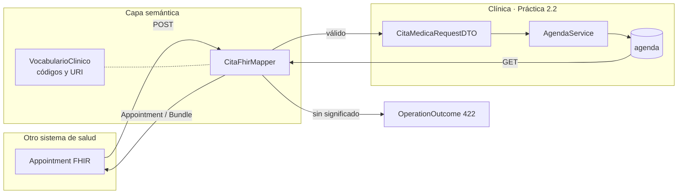

# Capa de intercambio de información semántica: la cita médica en HL7 FHIR

- **Estudiante:** William Cabrera (`4NDR3S-01`)
- **Asignatura:** Integración e Implementación de Software
- **Rama:** `practica-semantica-cita-medica` (construida sobre `practica-dto-cita-medica`, la Práctica 2.2)
- **Script de demostración:** `infraestructura/pruebas/demo-semantica.sh`

> **Guía para el día de la presentación.** Las secciones 1 a 4 explican la práctica. Las secciones 5 a 9 dicen qué hace cada integrante, en qué orden, cómo comprobar cada paso, qué decir en la demostración y cómo resolver cada problema sin detenerse.

---

## 1. La práctica en 30 segundos

En la Práctica 2.2 la cita médica tiene un **contrato JSON** que asegura la **estructura** de los datos: qué campos lleva y de qué tipo. Esa estructura, sin embargo, solo la entiende nuestro sistema:

```json
{ "codigo_paciente": "001", "fecha": "2026-11-20", "hora_inicio": "10:00", "estado": "programada" }
```

Para un hospital, una aseguradora o el Ministerio de Salud, `codigo_paciente`, `programada` y `10:00` no significan nada. No saben de qué paciente se trata, qué estado es ese ni en qué zona horaria está la hora.

Esta práctica agrega una **capa semántica**: la cita se publica y se recibe en el estándar internacional de salud **HL7 FHIR R4** (recurso `Appointment`). Cada dato lleva un **código** de un **vocabulario público identificado por una URI**, así que cualquier sistema que use FHIR entiende lo mismo que nosotros.

## 2. Conceptos que hay que poder explicar

| Nivel de interoperabilidad | Pregunta que responde | En el proyecto |
|---|---|---|
| Técnico | ¿Los sistemas se pueden conectar? | HTTP, JSON, NGINX y Tailscale |
| Sintáctico | ¿Los datos tienen la forma correcta? | Práctica 2.2: DTO y JSON Schema |
| **Semántico** | **¿Los dos entienden lo mismo?** | **Esta práctica: FHIR y sus vocabularios** |

- **HL7 FHIR:** estándar internacional para intercambiar información de salud. Define *recursos* como `Patient`, `Appointment` u `Observation`.
- **Vocabulario o sistema de códigos:** una lista oficial de códigos con significado fijo, identificada por una URI. Ejemplo: en `http://terminology.hl7.org/CodeSystem/service-category`, el código `10` significa *Dental* para todo el mundo.
- **El par `system` + `code`:** es como un diccionario con dirección. El código `10` solo no dice nada; *"el código 10 del sistema service-category de HL7"* es inequívoco.
- **Identificador con sistema:** `001` puede ser cualquier cosa. `urn:proyect-clinico:codigo-paciente|001` es el paciente 001 de **esta** clínica. Una cédula se identifica con otro sistema: `urn:proyect-clinico:cedula-ecuador|1312345678`.
- **Instante con zona horaria:** `10:00` es ambiguo. `2026-11-20T10:00:00-05:00` y `2026-11-20T15:00:00Z` son **el mismo instante**.
- **OperationOutcome:** la forma estándar en que FHIR explica por qué rechazó algo.

## 3. Qué se construyó



**Idea clave para la exposición:** la regla de negocio no se duplica. Una cita que llega en FHIR pasa por el **mismo** DTO de la 2.2 y el **mismo** `AgendaService` que usan la web y el móvil, con el mismo control de horario ocupado, la misma auditoría y la misma transacción.

| Archivo | Responsabilidad |
|---|---|
| `app/Semantica/VocabularioClinico.php` | Vocabulario compartido: URI, códigos y tablas de equivalencia |
| `app/Semantica/CitaFhirMapper.php` | Agenda → Appointment (exportar) y Appointment → `CitaMedicaRequestDTO` (importar) |
| `app/Semantica/ErrorSemantico.php` | Errores en formato `OperationOutcome` |
| `app/Http/Controllers/Api/Semantica/CitaFhirController.php` | Los 4 endpoints |
| `tests/Feature/SemanticaCitaFhirTest.php` | 16 pruebas, 125 aserciones |
| `docs/contratos/cita-medica/fhir/*.json` | Ejemplos reales, válidos según el esquema oficial de FHIR R4 |
| `infraestructura/pruebas/demo-semantica.sh` | Demostración guiada en vivo |

### Endpoints

Todos son **solo para la doctora**: hay que enviar `Authorization: Bearer <token>`. Responden con `Content-Type: application/fhir+json`.

| Método y ruta | Qué hace |
|---|---|
| `GET /api/semantica/vocabulario` | Publica la tabla de mapeo |
| `GET /api/semantica/fhir/Appointment?date=AAAA-MM-DD` | Citas del día como `Bundle` |
| `GET /api/semantica/fhir/Appointment/{id}` | Una cita como `Appointment` |
| `POST /api/semantica/fhir/Appointment` | Importa una cita FHIR: 201 con `Location`, 409 o 422 |

## 4. Vocabulario y reglas

### Tabla de mapeo

| Dato interno | FHIR `Appointment` | Vocabulario (URI) |
|---|---|---|
| `id` | `id` e `identifier` | `urn:proyect-clinico:agenda` |
| `estado` | `status` | Value set `appointmentstatus` de FHIR |
| `tipo = cita_medica` | `serviceCategory` = `10` Dental | `http://terminology.hl7.org/CodeSystem/service-category` |
| (consulta programada) | `appointmentType` = `ROUTINE` | `http://terminology.hl7.org/CodeSystem/v2-0276` |
| `fecha` + `hora_inicio` / `hora_fin` | `start` / `end`: instante con zona | ISO 8601 · `America/Guayaquil` (UTC−05:00) |
| `descripcion` | `description` | — |
| `paciente.codigo_paciente` | `participant.actor.identifier` | `urn:proyect-clinico:codigo-paciente` |
| `paciente.cedula` (solo al importar) | `participant.actor.identifier` | `urn:proyect-clinico:cedula-ecuador` |
| `paciente.nombres` / `nombre_reserva` | `participant.actor.display` | — |
| `created_at` | `created` | ISO 8601 |

| Estado interno | `status` FHIR | ¿Se puede importar? |
|---|---|---|
| `pendiente` | `proposed` | No |
| `programada` | `booked` | **Sí** |
| `completada` | `fulfilled` | No |
| `cancelada` | `cancelled` | No |

**No se comparte:** `diagnostico`, `tratamiento`, `observacion` ni las entradas personales de la agenda de la doctora. La capa semántica también decide qué información sale del sistema.

Los URN `urn:proyect-clinico:*` son convenciones de este proyecto. Los vocabularios de `terminology.hl7.org` son los oficiales de HL7.

### Reglas al importar

Un 422 no solo significa que falta un campo. También se devuelve cuando el dato **no tiene significado** para el consultorio.

| Caso | `issue.code` | Ejemplo |
|---|---|---|
| Estado sin equivalente | `code-invalid` | `"status": "arrived-late"` |
| Estado que no es una cita confirmada | `not-supported` | `"status": "proposed"` |
| Categoría que no es odontología | `code-invalid` | `serviceCategory` 27 Mental Health |
| Sistema de identificación desconocido | `code-invalid` | `"system": "urn:otro-hospital:hc"` |
| Cédula o código inexistente | `not-found` | cédula `0999999999` |
| Hora sin zona horaria (ambigua) | `value` | `"2026-11-20 10:00"` |
| Fin anterior al inicio, o en otro día local | `business-rule` | — |
| Horario ocupado | `conflict` (HTTP 409) | — |

Todos los problemas se informan juntos en un solo `OperationOutcome`, y no se guarda nada.

**El mismo instante en otro formato es la misma cita:**
- `2026-11-20T15:00:00Z` se guarda como el 20/11 a las **10:00**, hora del consultorio.
- `2026-11-21T02:00:00Z` se guarda como el **20/11 a las 21:00**: en Ecuador todavía es el día anterior.

---

## 5. Preparación del sistema distribuido (día de la presentación)

**Hacerlo 30 minutos antes, no frente al docente.** Cada integrante ejecuta solo lo de su laptop, **en este orden**: base de datos → archivos → backend → web → balanceador. Al terminar, avisa al grupo con un "listo".

### Paso 0 · Todos: Tailscale

1. Abrir **Tailscale** e iniciar sesión hasta que diga **Connected**.
2. Comprobar la IP en PowerShell o en una terminal: `tailscale ip -4`. Debe ser la de esta tabla:

| Laptop | Responsable | IP Tailscale |
|---|---|---|
| L1 Balanceador (Kali) | 4ndr3s-principal (William) | 100.102.99.114 |
| L2 Web | jerenyvera09 (Jereny) | 100.70.229.10 |
| L3 Backend | jordyalex32 (Jordy) | 100.92.238.94 |
| L4 Base de datos | Luis-M25 (Luis) | 100.104.9.95 |
| L5 Archivos (FTP) | andriwgamesyt (Andriw) | 100.127.65.82 |

> Funciona igual en el wifi de la universidad, en el switch o en casa. Lo único que importa es que Tailscale esté **Connected**.

### Paso 1 · Luis (L4, PostgreSQL)

En PowerShell **como administrador**:
```powershell
Get-Service postgresql*                    # debe decir Running
Get-Service postgresql* | Start-Service    # solo si dice Stopped
```
**Comprobación:** `Get-Service postgresql*` muestra **Running**.

**Además, una sola vez:** la cuenta de la doctora debe tener el correo verificado. Si no lo tiene, el login responde *"Debes verificar tu correo antes de iniciar sesión"*. Ejecutar en pgAdmin o en psql, conectado a `proyect_clinico` en el puerto 5433:
```sql
SELECT username, email_verified_at FROM seguridad.users WHERE username = 'doctora';
-- Si email_verified_at está vacío:
UPDATE seguridad.users SET email_verified_at = now() WHERE username = 'doctora';
```

**Además:** debe existir al menos **un paciente con cédula**, que se puede crear desde la web en Pacientes. El script lo usa como "el paciente que llega desde otro sistema".

### Paso 2 · Andriw (L5, archivos)

```powershell
cd <repo>\servidor_ftp
Set-ExecutionPolicy -Scope Process Bypass
.\iniciar.ps1
```
**Comprobación:** la ventana muestra el servidor escuchando en el puerto 2121.

> Si el FTP no arranca, **no bloquea la demostración**: el sistema queda en estado "degradado" y el script continúa.

### Paso 3 · Jordy (L3, backend con la rama de la práctica)

En PowerShell, en la carpeta del repositorio:
```powershell
git status                                  # si hay cambios propios sin guardar: git stash
git fetch https://github.com/4NDR3S-01/proyect_clinico.git practica-semantica-cita-medica
git switch -c practica-semantica-cita-medica FETCH_HEAD
#   (si la rama ya existía de antes:  git switch practica-semantica-cita-medica ; git reset --hard FETCH_HEAD)
cd backend-api
composer install
php artisan optimize:clear
cd despliegue
Set-ExecutionPolicy -Scope Process Bypass
.\detener.ps1        # detiene las instancias viejas (si no había ninguna, solo lo avisa)
.\iniciar.ps1        # abre backend1 (8001) y backend2 (8002), cada uno en su ventana
```
- **No hace falta migrar**: la práctica no cambia la base de datos.
- **No se toca** `backend-api\.env`: sigue apuntando a la base de Luis y al FTP de Andriw.

**Comprobación (en la misma laptop):**
```powershell
curl.exe -s http://127.0.0.1:8001/api/health
curl.exe -s http://127.0.0.1:8002/api/health
```
Las dos deben responder `"estado":"ok"` o `"estado":"degradado"`. Si responden `"error"`, el backend no llega a PostgreSQL: revisar el paso 1.

### Paso 4 · Jereny (L2, web)

La web **no cambia** con esta práctica. Basta con que NGINX esté corriendo:
```powershell
C:\nginx\nginx.exe -p C:\nginx\            # iniciar (si ya está corriendo, da un error de puerto ocupado: es normal)
```
**Comprobación:** el balanceador abre la web en `http://100.102.99.114/`.

### Paso 5 · William (L1, balanceador)

```bash
sudo systemctl status nginx --no-pager     # active (running)
sudo systemctl restart nginx               # solo si no está activo
```

## 6. Verificación final desde L1 (5 minutos antes)

Ejecutar en la laptop de William, en orden. **Si todo sale como en la columna "Esperado", el sistema está listo.**

| # | Comando | Esperado |
|---|---|---|
| 1 | `tailscale status` | Las 5 laptops **sin** la palabra `offline` |
| 2 | `curl -s http://100.102.99.114/api/health` | `"estado":"ok"` (o `"degradado"` si falta el FTP) |
| 3 | `infraestructura/pruebas/balanceo.sh http://100.102.99.114 10` | Peticiones atendidas por **backend1 y backend2** |
| 4 | `curl -s -o /dev/null -w '%{http_code}\n' -H 'Accept: application/json' http://100.102.99.114/api/semantica/vocabulario` | **401**: la rama está desplegada y pide login. **404**: Jordy no tiene la rama (repetir el paso 3). |
| 5 | Abrir `http://100.102.99.114/` e iniciar sesión como doctora | Entra a la web |
| 6 | **Ensayo completo:** `SIN_PAUSAS=1 infraestructura/pruebas/demo-semantica.sh` | Termina en "Fin de la demostración" y borra la cita de prueba |

> En el paso 4 la cabecera `Accept: application/json` es obligatoria. Sin ella, cualquier ruta protegida del backend responde 500 en lugar de 401.

## 7. Demostración en vivo (guion)

Lo ejecuta William en L1, con la terminal en pantalla completa y la letra grande (`Ctrl` + `+`). En otra ventana debe estar abierta la **web de la doctora en la Agenda**.

```bash
cd ~/Documentos/proyect_clinico
infraestructura/pruebas/demo-semantica.sh
```

El script pide la clave de la doctora sin mostrarla y avanza **un paso cada vez que se presiona Enter**. Todo lo que puede fallar en vivo lo resuelve solo:
- busca un paciente real con cédula;
- elige un horario libre, 7 días después de hoy desde las 07:00;
- guarda el token;
- **borra la cita de prueba al terminar**, también si se interrumpe con `Ctrl+C`.

| Paso del script | Qué se ve | Qué decir |
|---|---|---|
| **0. Estado del sistema** | `/api/health` y qué instancia atendió | "La petición entra por el balanceador y la atiende una de las dos instancias del backend, que consulta la base de datos de la L4." |
| **1. Inicio de sesión** | ✔ Sesión iniciada | "La capa semántica es solo para la doctora: datos de salud, acceso restringido." |
| **2. Vocabulario** | Tabla interno → FHIR y lo que no se comparte | "Este es el diccionario común. `programada` es nuestro; `booked` lo entiende cualquier sistema FHIR. Y decidimos qué **no** sale: diagnóstico y tratamiento." |
| **3. Cita de otro sistema** | JSON FHIR con **cédula** y hora en **UTC (Z)** | "Imaginemos que el sistema de un hospital nos deriva una cita. No conoce nuestro código de paciente: usa la cédula. Y manda la hora en UTC." |
| **4. Respuesta 201** | La misma cita con hora `-05:00` y código `001` | "La capa interpretó el significado: las 12:00 UTC son las 07:00 en Ecuador, y la cédula corresponde a nuestro paciente 001. Pasó por el mismo DTO y servicio que usa la web." **→ Mostrar la cita en la web de la doctora.** |
| **5. Bundle** | Las citas del día en formato estándar | "Ahora es al revés: publicamos nuestras citas para que otro sistema las entienda sin conocer nuestra base de datos." |
| **6. Datos sin significado** | 422 con **4 problemas** | "La estructura JSON es válida, pero el significado no: un estado que no existe, una categoría que no es odontología, una hora sin zona y un identificador de un sistema que no conocemos. Se rechaza todo junto y no se guarda nada." |
| **7. Repetir la cita** | 409 `conflict` | "La regla de negocio es la misma de siempre: no hay dos citas en el mismo horario." |

Al final aparece **"✔ Cita de prueba … borrada"**: la base queda como estaba.

**Opciones útiles:**
```bash
MANTENER_CITA=1 infraestructura/pruebas/demo-semantica.sh      # no borra la cita (para mostrarla con calma en la web)
PACIENTE_CEDULA=1312345678 infraestructura/pruebas/demo-semantica.sh   # usar un paciente concreto
DIAS=3 infraestructura/pruebas/demo-semantica.sh               # cita dentro de 3 días en vez de 7
```

## 8. Si algo falla en vivo

| Síntoma | Causa | Solución inmediata |
|---|---|---|
| `✘ No hay respuesta de http://100.102.99.114` | L1 sin Tailscale o NGINX detenido | `tailscale status` · `sudo systemctl restart nginx` |
| `/api/health` responde 502 o 503 | Las dos instancias del backend están caídas | Jordy: `.\iniciar.ps1` en `backend-api\despliegue` |
| `✘ El backend no llega a la base de datos` | PostgreSQL de la L4 detenido o Luis sin Tailscale | Luis: `Get-Service postgresql* \| Start-Service` y revisar Tailscale |
| `Login rechazado: verificar tu correo` | La doctora no tiene `email_verified_at` | El `UPDATE` del paso 1 (Luis) |
| `Login rechazado: usuario o contraseña` | Clave mal escrita | Volver a ejecutar el script y escribirla con calma |
| `✘ El backend no tiene la capa semántica` | L3 sigue en la rama vieja | Jordy repite el paso 3 completo, incluido `.\detener.ps1` y `.\iniciar.ps1` |
| `No hay pacientes con cédula` | Base sin pacientes | Crear uno en la web (Pacientes → Nuevo) o usar `PACIENTE_CEDULA=...` |
| El paso 4 da 422 `not-found` | La cédula de `PACIENTE_CEDULA` no existe | Ejecutar sin `PACIENTE_CEDULA` para que elija uno real |
| `"estado":"degradado"` | El FTP de la L5 está apagado | No afecta: la demostración continúa |
| Se cae una instancia del backend en plena demo | — | No pasa nada: NGINX envía la petición a la otra (es la resiliencia de la Unidad 3) |

### Plan B (si la red no levanta)

1. Mostrar las **pruebas automatizadas** en la laptop de William:
   ```bash
   cd ~/Documentos/proyect_clinico && git switch practica-semantica-cita-medica
   cd backend-api && php artisan test --filter=SemanticaCitaFhirTest
   ```
   Deben salir 16 pruebas aprobadas. Cada nombre de prueba corresponde a un paso del guion: exporta, importa por cédula, UTC a hora local, rechazo de códigos, 409, ida y vuelta.
2. Abrir los ejemplos reales en `backend-api/docs/contratos/cita-medica/fhir/`:
   - `appointment-entrada-externa.json`: lo que manda el otro sistema;
   - `appointment-respuesta-201.json`: lo que devuelve la clínica;
   - `operation-outcome-422.json`: el rechazo.

## 9. Después de la presentación

Jordy deja el backend como estaba:
```powershell
git switch master
cd backend-api\despliegue
.\detener.ps1
.\iniciar.ps1
```

---

## 10. Evidencias

```bash
php artisan test --filter=SemanticaCitaFhirTest      # 16 pruebas, 125 aserciones
php artisan test --filter=CitaMedicaContratoTest     # contrato 2.2 intacto: 9 pruebas
```

- **Qué cubren las pruebas:**
  - el mapeo de los 4 estados;
  - que no se exponen datos clínicos ni entradas personales;
  - el Bundle por día;
  - la importación por código interno, por cédula y de un paciente sin registro;
  - la conversión de UTC a hora local, incluido el cruce de medianoche;
  - los códigos sin significado y las reglas de negocio;
  - el 409;
  - la **ida y vuelta**: exportar y volver a importar conserva el significado;
  - que solo la doctora tiene acceso.
- **Esquema oficial:** los ejemplos de `docs/contratos/cita-medica/fhir/` son respuestas reales de la API. Se validaron con el **esquema JSON oficial de FHIR R4** de HL7 (`https://hl7.org/fhir/R4/fhir.schema.json.zip`), y los cuatro documentos (entrada, Appointment, Bundle y OperationOutcome) son válidos.
- **Ensayo completo:** `demo-semantica.sh` se ejecutó de principio a fin contra el backend con **PostgreSQL 18 real**. Dio 201, Bundle, 422 con 4 problemas y 409, y la cita de prueba se borró al final. También se comprobaron sus mensajes cuando no hay conexión y cuando la clave es incorrecta.
- **Suite completa del backend:** 180 pruebas aprobadas, 23 omitidas y 2 fallidas. Las 2 fallas son de `AuditoriaTransaccionesTest` (columna `agenda.nombre_reserva`) y ya fallaban en `upstream/master` antes de esta práctica.

## 11. Presentación sugerida (10 diapositivas)

1. **Título:** Capa de intercambio de información semántica: la cita médica en HL7 FHIR.
2. **Los tres niveles de interoperabilidad** (tabla de la sección 2).
3. **El problema:** el JSON interno frente a cómo lo leería otro sistema.
4. **El estándar:** FHIR, el recurso `Appointment` y el par `system` + `code`.
5. **La tabla de mapeo** y lo que no se comparte (sección 4).
6. **La arquitectura** (diagrama de la sección 3): se reutiliza el DTO y el servicio de la 2.2.
7. **Demostración en vivo** (sección 7).
8. **Reglas de significado:** OperationOutcome y el ejemplo de UTC que cruza la medianoche.
9. **Evidencias:** pruebas, ida y vuelta y validación con el esquema oficial.
10. **Conclusión y trabajo futuro:** terminologías clínicas (SNOMED CT o CIE-10) para los diagnósticos, un recurso `Patient` y perfiles nacionales.

### Preguntas probables

- **¿Por qué FHIR y no un JSON propio?** Porque un JSON propio solo lo entendemos nosotros. FHIR es el estándar internacional de salud y sus vocabularios son públicos.
- **¿En qué se diferencia de la 2.2 y la 2.3?** La 2.2 valida la estructura y la 2.3 traduce nombres de campos. Esta práctica asegura que el **significado** sea el mismo en los dos sistemas: códigos, identificadores y zona horaria.
- **¿Por qué rechazar una hora sin zona?** Porque es ambigua: las "10:00" de Madrid no son las 10:00 de Manta. Guardarla sin zona sería adivinar.
- **¿Por qué no se exporta el diagnóstico?** Por privacidad. La capa semántica también define qué información sale del sistema.
- **¿Se duplicó la lógica?** No. Lo importado pasa por el mismo DTO de la 2.2 y el mismo `AgendaService` que usan la web y el móvil.
