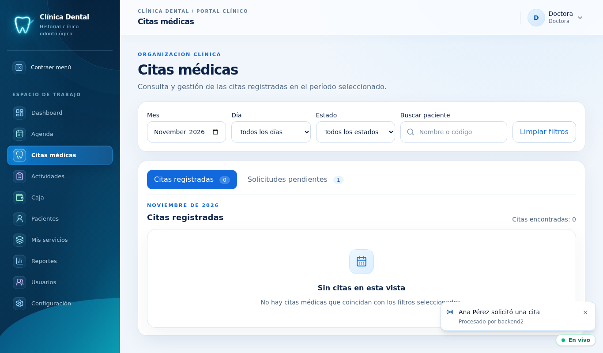

# Práctica: arquitectura reactiva y orientada a eventos — cita médica

Guía para preparar y hacer la demostración **en una sola laptop**. Al final están las
variantes con dos laptops y con los cinco nodos.

---

## 1. El problema y la solución

### El problema

Cuando una paciente solicita, cancela o reprograma una cita, la doctora **no se entera**
hasta que vuelve a cargar la página. La web solo sabía **preguntar** al servidor
(petición–respuesta, *pull*):

- el aviso llega tarde (cuando la web vuelve a consultar);
- se hacen peticiones aunque nada haya cambiado;
- cada pantalla que quiera enterarse tiene que preguntar por su cuenta.

### La solución

Que el sistema **avise** en cuanto algo pasa (*push*) y que cada interesado **reaccione solo**:

| Problema | Qué se hizo | Dónde está |
|---|---|---|
| Nadie se entera de que la cita cambió | Cada cambio de la cita genera un **evento** («cita solicitada», «cita cancelada»…) | `backend-api/app/Observers/AgendaObserver.php` y `app/Events/CitaCambioEstado.php` |
| La web tiene que preguntar para enterarse | El backend **empuja** el evento por **WebSocket** a la web de la doctora, que se actualiza sola | `app/Listeners/DifundirCambioDeCita.php`, **Laravel Reverb**, `frontend-web/src/features/realtime/` |
| Guardar un registro hace esperar al usuario | La bitácora se escribe **en segundo plano**, con una **cola** y un worker | `app/Listeners/RegistrarEventoDeCita.php`, `php artisan queue:work` |
| Agregar una reacción nueva obligaría a tocar el código de las citas | **Publicar/suscribir**: cada reacción se suscribe al evento por su cuenta | `app/Providers/AppServiceProvider.php` (`Event::listen`) |
| Cualquiera podría escuchar los avisos | **Canales privados**: solo la doctora o la paciente dueña | `routes/channels.php` |
| Si falla el sistema de avisos, se podría perder la cita | Si Reverb no responde, la cita **se guarda igual** y queda una advertencia | `try/catch` en `DifundirCambioDeCita.php` |
| Avisar de una cita que al final no se guardó | El evento sale **solo después del COMMIT** en la base de datos | `ShouldHandleEventsAfterCommit` en `AgendaObserver.php` |

### Cómo se conecta todo

```
 Paciente (curl o app)                                    Web de la doctora
      │ POST /api/agenda/solicitar-cita                          ▲ aviso + agenda al día
      ▼                                                           │ (WebSocket)
   Backend ── guarda la cita en PostgreSQL ── COMMIT              │
      │                                                           │
      └─► AgendaObserver publica el evento CitaCambioEstado        │
              ├─► Consumidor 1 ──► Reverb ────────────────────────┘   (al instante)
              └─► Consumidor 2 ──► cola «eventos» ──► worker ──► eventos.log   (en segundo plano)
```

---

## 2. Preparación en una sola laptop (una vez, antes de presentar)

Todo corre en tu laptop: base de datos, backend, Reverb, worker y web. No depende de la
red ni de las otras laptops. Comandos para Linux (Kali). Haz todo desde la carpeta del
proyecto.

### 2.1 Base de datos local (PostgreSQL)

```bash
sudo systemctl start postgresql
sudo -u postgres psql -c "CREATE USER clinica_app WITH PASSWORD 'demo123' SUPERUSER;"
sudo -u postgres createdb -O clinica_app proyect_clinico
```

### 2.2 Configurar el backend

Guarda una copia de tu configuración actual, que apunta a la base del equipo:

```bash
cd backend-api
cp .env .env.respaldo
```

En `backend-api/.env`, cambia o agrega estas líneas:

```ini
DB_HOST=127.0.0.1
DB_PORT=5432
DB_DATABASE=proyect_clinico
DB_USERNAME=clinica_app
DB_PASSWORD=demo123

BROADCAST_CONNECTION=reverb
QUEUE_CONNECTION=database
REVERB_APP_ID=clinica
REVERB_APP_KEY=clinica-clave
REVERB_APP_SECRET=cambia-este-secreto
REVERB_HOST=127.0.0.1
REVERB_PORT=8085
REVERB_SCHEME=http
REVERB_SERVER_HOST=0.0.0.0
REVERB_SERVER_PORT=8085
```

Prepara la base y crea las cuentas de la demostración:

```bash
composer install
php artisan config:clear
php artisan migrate --force
DOCTORA_PASSWORD='Demo-2026!' php artisan db:seed --force
php artisan tinker --execute='
$p = App\Models\Paciente::create(["codigo_paciente"=>"0001","nombres"=>"Ana Pérez","cedula"=>"1312345678"]);
App\Models\User::create(["name"=>"Ana Pérez","username"=>"ana","email"=>"ana@demo.test","password"=>"Demo-2026!","role"=>"paciente","paciente_id"=>$p->id]);
App\Models\User::query()->update(["activo"=>true,"email_verified_at"=>now()]);'
```

Quedan dos cuentas:

| Rol | Usuario | Contraseña |
|---|---|---|
| Doctora | `doctora` | `Demo-2026!` |
| Paciente | `ana` | `Demo-2026!` |

Para volver a usar la base del equipo después de la presentación: `cp .env.respaldo .env`.

### 2.3 Configurar la web

Crea el archivo `frontend-web/.env.local` con:

```ini
VITE_API_BASE_URL=http://127.0.0.1:8001/api
VITE_REVERB_APP_KEY=clinica-clave
VITE_REVERB_HOST=127.0.0.1
VITE_REVERB_PORT=8085
```

y ejecuta `npm install` en `frontend-web`.

### 2.4 Antes de que empiece la presentación

Deja corriendo el sistema «normal». No hace falta explicarlo:

```bash
# Terminal "Backend" (carpeta backend-api)
BACKEND_INSTANCE=backend1 php -S 127.0.0.1:8001 -t public

# Terminal "Web" (carpeta frontend-web)
npm run dev
```

Abre `http://localhost:5173` en el navegador, pero **no inicies sesión todavía**.

### 2.5 Ensayo

Haz los pasos de la sección 3 una vez completos. Si algo no responde, revisa la [sección 5](#5-si-algo-falla).

---

## 3. Demostración en vivo, paso a paso (≈10 minutos)

Ventanas abiertas, de izquierda a derecha:

| Ventana | Para qué |
|---|---|
| **Navegador** | La web de la doctora |
| **Terminal 1 — Reverb** | El servidor de eventos. La abres en el paso 1 |
| **Terminal 2 — Cola** | El consumidor en segundo plano. La abres en el paso 2 |
| **Terminal 3 — Paciente** | Aquí actúas como la paciente con `curl` |

Las terminales 1 y 2 van en la carpeta `backend-api`; la Terminal 3, en la carpeta del proyecto.

Cada paso tiene:

- **Haz:** lo que escribes o haces.
- **Qué pasa:** lo que aparece en pantalla.
- **Qué se hizo:** la parte de la solución que lo hace posible.
- **Explica:** una frase para el público.

---

### Paso 0 — Mostrar el problema (1 minuto)

**Haz:** en el navegador, inicia sesión como `doctora` y entra a **Citas médicas**. Todavía no enciendas nada más.

**Qué pasa:** abajo a la derecha aparece **● Sin conexión en vivo** (o «Conectando…»). La web funciona, pero no tiene forma de enterarse sola de los cambios.

**Explica:**
> «Así estaba el sistema: si una paciente pide una cita, la doctora no se entera hasta que recarga la página. La web solo sabe preguntar. Vamos a encender las piezas que lo cambian.»

---

### Paso 1 — Encender el servidor de eventos (Reverb)

**Haz** (Terminal 1):
```bash
php artisan reverb:start --debug
```

**Qué pasa:**
- En la terminal: `INFO  Starting server on 0.0.0.0:8085.`
- En el navegador, en unos segundos, el indicador cambia solo a **● En vivo** (verde).
- En la terminal aparece `Connection Established`: es la web de la doctora conectándose.

**Qué se hizo:** se agregó **Laravel Reverb**, un servidor de WebSockets. La web de la doctora (`frontend-web/src/features/realtime/realtimeService.ts`) abre una conexión permanente con él y se reconecta sola si se corta.

**Explica:**
> «Reverb mantiene una conexión abierta con cada navegador. Por ahí el servidor puede avisar sin que nadie pregunte.»

---

### Paso 2 — Encender el consumidor de la cola (worker)

**Haz** (Terminal 2):
```bash
php artisan queue:work --queue=eventos,default --sleep=1
```

**Qué pasa:** la terminal queda esperando trabajos.

**Qué se hizo:** la bitácora (`RegistrarEventoDeCita.php`) se marcó con `implements ShouldQueue`, así que no se ejecuta durante la petición del usuario: se guarda en la cola (tabla `jobs`) y la procesa este worker.

**Explica:**
> «Este proceso atiende los trabajos que no son urgentes. Por eso nadie tiene que esperar a que se escriba la bitácora.»

---

### Paso 3 — Mostrar el canal privado

**Haz** (Navegador): **F12** → pestaña **Red** (*Network*) → filtro **WS** → haz clic en la conexión → pestaña **Mensajes**.

**Qué pasa:** se ve el mensaje `pusher:subscribe` al canal `private-clinica.doctora` y la respuesta `pusher_internal:subscription_succeeded`.

**Qué se hizo:** para entrar a un canal privado, la web pide permiso al backend (`/api/broadcasting/auth`) con su token de sesión, y `routes/channels.php` decide: solo la doctora entra a `clinica.doctora`, y cada paciente solo a su propio `paciente.{id}`.

**Explica:**
> «Los avisos no son públicos. El backend comprueba quién es antes de dejarla escuchar.»

---

### Paso 4 — La paciente inicia sesión

**Haz** (Terminal 3):
```bash
API=http://127.0.0.1:8001/api
curl -s -X POST $API/auth/login -H 'Accept: application/json' -H 'Content-Type: application/json' \
  -d '{"username":"ana","password":"Demo-2026!"}' | jq
```

**Qué pasa:** una respuesta JSON con `"access_token": "2|AbC..."`. Cópiala y guárdala:
```bash
TOKEN='2|AbC...'
```

**Explica:**
> «Ahora soy la paciente. Con este token hago lo mismo que haría la app móvil.»

---

### Paso 5 — La paciente solicita una cita ⭐ (el paso central)

**Haz** (Terminal 3):
```bash
curl -i -X POST $API/agenda/solicitar-cita -H 'Accept: application/json' -H "Authorization: Bearer $TOKEN"
```

**Qué pasa**, en este orden (señala cada ventana):
1. **Terminal 3:** `HTTP/1.1 201 Created`. Copia el `"id"` de la cita y guárdalo: `CITA='01a1...'`.
2. **Navegador:** aparece el aviso **«Ana Pérez solicitó una cita»** y el contador de *Solicitudes pendientes* sube a 1 **sin recargar**. En la pestaña WS llega el mensaje `cita_actualizada` con los datos del evento.
3. **Terminal 1 (Reverb):** `Message Received` / `Message Handled`: el mensaje que repartió.
4. **Terminal 2 (Cola):** `App\Listeners\RegistrarEventoDeCita ... DONE`.

**Qué se hizo:**
- El backend guarda la cita como siempre. El código del caso de uso **no cambió**.
- `AgendaObserver` vigila las citas y, **después del COMMIT**, publica el evento `CitaCambioEstado` de tipo `solicitada`.
- Dos suscriptores reaccionan por separado:
  - `DifundirCambioDeCita` lo envía por Reverb al instante: es el aviso en la web.
  - `RegistrarEventoDeCita` lo deja en la cola para la bitácora.
- La web recibe el mensaje y vuelve a pedir la agenda (`LiveAppointments.tsx`): por eso el contador se actualiza.

**Explica:**
> «La paciente hizo **una** petición. El backend guardó la cita y publicó **un** evento. Dos partes reaccionaron por su cuenta: una avisó a la doctora al instante y la otra escribió la bitácora. La paciente no sabe que existen. Eso es el desacoplamiento de publicar/suscribir.»

---

### Paso 6 — La doctora programa la cita

**Haz** (Navegador): pestaña **Solicitudes pendientes** → **Programar** → una fecha futura y una hora → guardar.

**Qué pasa:** en la pestaña WS llega un mensaje con `"tipo": "programada"`, y lo ves también en las terminales 1 y 2.

**Qué se hizo:** el mismo observador detecta que el estado pasó de `pendiente` a `programada` y publica otro tipo de evento. No se programó un aviso aparte para esta acción. El evento también se envía al canal privado de la paciente: su app podría enterarse sin preguntar.

**Explica:**
> «Ahora la que produce el evento es la doctora. Cualquier cambio de la cita, venga de quien venga, se convierte en un evento.»

---

### Paso 7 — La paciente cancela

**Haz** (Terminal 3):
```bash
curl -i -X PUT $API/agenda/mis-citas/$CITA/cancelar -H 'Accept: application/json' -H "Authorization: Bearer $TOKEN"
```

**Qué pasa:** `HTTP/1.1 200`, el aviso **«Ana Pérez canceló su cita»** y la agenda se actualiza sola.

**Qué se hizo:** en el observador, un `match` traduce cada cambio de estado en su tipo de evento: `solicitada`, `programada`, `reprogramacion_solicitada`, `cancelada`, `completada`…

**Explica:**
> «Tres acciones distintas, de dos personas distintas, y la doctora se enteró de todas al instante.»

---

### Paso 8 — La bitácora

**Haz** (Terminal 3):
```bash
tail -n 3 backend-api/storage/logs/eventos.log
```

**Qué pasa:** tres líneas JSON: `cita.solicitada`, `cita.programada` y `cita.cancelada`, con fecha, paciente e instancia.

**Qué se hizo:** es el segundo consumidor. Lo escribió el worker de la Terminal 2, en segundo plano.

**Explica:**
> «Quedó registro de todo y nadie esperó por ello.»

---

### Paso 9 — Resiliencia: se cae el servidor de eventos

**Haz:**
1. En la **Terminal 1**, presiona **Ctrl+C** para apagar Reverb. El navegador cambia a **● Sin conexión en vivo**.
2. En la **Terminal 3**, la paciente vuelve a solicitar una cita:
   ```bash
   curl -i -X POST $API/agenda/solicitar-cita -H 'Accept: application/json' -H "Authorization: Bearer $TOKEN"
   ```
3. Muestra la advertencia del backend:
   ```bash
   grep "No se pudo difundir" backend-api/storage/logs/laravel-*.log | tail -n 1
   ```
4. Enciende Reverb otra vez en la **Terminal 1**: `php artisan reverb:start --debug`.

**Qué pasa:**
- La solicitud respondió **`201 Created`**: la cita **se guardó igual**.
- El log dice `No se pudo difundir el evento de la cita por WebSocket`.
- La **Terminal 2** sí procesó el evento: la bitácora no depende de Reverb.
- Al volver Reverb, el navegador regresa solo a **● En vivo**, sin recargar.

**Qué se hizo:** el envío por WebSocket está protegido con `try/catch` en `DifundirCambioDeCita.php`. Si falla, se anota una advertencia y la petición termina bien. Los dos consumidores son independientes: que uno falle no detiene al otro.

**Explica:**
> «Falló el sistema de avisos, no el negocio. Es degradación controlada: el sistema sigue funcionando con menos, y se recupera solo.»

**Al terminar:** cancela esa última solicitud. Copia su `id` y repite el paso 7, para dejar a la paciente lista para otra demostración.

---

## 4. Mostrar el código (2 minutos)

Abre los archivos en este orden (en `backend-api/`, salvo el último):

| # | Archivo | Qué señalar |
|---|---|---|
| 1 | `app/Observers/AgendaObserver.php` | `implements ShouldHandleEventsAfterCommit`: solo publica si la cita se guardó de verdad. El `match` traduce el cambio de estado en el tipo de evento. |
| 2 | `app/Events/CitaCambioEstado.php` | El evento: los datos del hecho y la instancia del backend que lo produjo. |
| 3 | `app/Providers/AppServiceProvider.php` | Las dos líneas `Event::listen(...)`. **Agregar una reacción nueva es una línea**, sin tocar al productor. |
| 4 | `app/Listeners/DifundirCambioDeCita.php` | El `try/catch`: por eso el paso 9 respondió 201. |
| 5 | `app/Listeners/RegistrarEventoDeCita.php` | `implements ShouldQueue`: esa sola línea lo manda a la cola. |
| 6 | `routes/channels.php` | Quién puede escuchar cada canal privado. |
| 7 | `frontend-web/src/features/realtime/LiveAppointments.tsx` | Al llegar el evento: `invalidateClinicalQueries(['agenda'])` refresca la agenda y aparece el aviso. |

---

## 5. Si algo falla

| Síntoma | Causa probable | Solución |
|---|---|---|
| La web dice **● Sin conexión en vivo** todo el tiempo | Reverb no está corriendo, o la clave no coincide | Revisa la Terminal 1. `VITE_REVERB_APP_KEY` (web) debe ser igual a `REVERB_APP_KEY` (backend). Si cambiaste `.env.local`, reinicia `npm run dev`. |
| La web dice **● En vivo** pero no llega el aviso | El backend no está publicando en Reverb | En `backend-api/.env`: `BROADCAST_CONNECTION=reverb`. Luego `php artisan config:clear` y reinicia la terminal «Backend». |
| No aparece el indicador | La sesión no es de la doctora, o falta `VITE_REVERB_APP_KEY` | Inicia sesión como `doctora`. Revisa `frontend-web/.env.local`. |
| Al solicitar: **409** «Ya tienes una solicitud de cita pendiente» | La paciente ya tiene una pendiente | Cancélala (paso 7 con su `id`). |
| **401** en `curl` | Token mal copiado | Repite el paso 4. El token va entre comillas simples. |
| La bitácora no cambia | El worker no está corriendo | Revisa la Terminal 2. Si cambiaste `.env`, reinícialo. |
| `Address already in use` | Ya hay otro proceso en ese puerto | Ciérralo, o búscalo con `lsof -i :8085` (o `:8001`, `:5173`). |
| `connection refused` al migrar | PostgreSQL apagado | `sudo systemctl start postgresql` |
| `jq: command not found` | Falta `jq` | Quita `\| jq`: el JSON sale en una sola línea; busca `access_token`. |

---

# Anexos

## Anexo A — Con dos laptops

Igual que la sección 2, pero la **Laptop 1** corre todo (base de datos, backend, Reverb,
worker y web) y la **Laptop 2** es la paciente. Así el público ve que el aviso cruza la red.
Las dos laptops deben estar en la misma red (switch, wifi o Tailscale). `IP1` es la IP de la Laptop 1.

**En la Laptop 1:**
- `frontend-web/.env.local`: `VITE_API_BASE_URL=http://IP1:8001/api` y `VITE_REVERB_HOST=IP1`.
- Backend: `BACKEND_INSTANCE=backend1 php -S 0.0.0.0:8001 -t public`.
- Web: `npm run dev -- --host`.
- Reverb y worker: igual que en los pasos 1 y 2. Reverb ya escucha en `0.0.0.0`.
- Si hay firewall, abre los puertos 8001, 8085 y 5173.

**En la Laptop 2:**
- Los pasos 4 a 9 de la paciente, con `API=http://IP1:8001/api`.
- Opcional: abre la web en `http://IP1:5173` e inicia sesión como doctora. El aviso llega a las dos pantallas a la vez.

## Anexo B — En los 5 nodos del proyecto

1. **`red.env` en todas las laptops:** agregar `REVERB_PORT=8085` y `REVERB_APP_KEY=clinica-clave` (ver `infraestructura/red.env.example`).
2. **Laptop 3 (backend):** en `backend-api\.env`, el bloque de Reverb de la sección 2.2, sin cambiar la base de datos. Luego `composer install` y `.\instalar.ps1`, que abre el puerto 8085 solo para el balanceador. `.\eventos.ps1` abre Reverb y el worker en dos ventanas.
3. **Laptop 1 (balanceador):** `sudo ./balanceador/instalar.sh`. Agrega a NGINX el paso de WebSockets `/app/` → Laptop 3:8085.
4. **Laptop 2 (web):** `.\instalar.ps1` vuelve a compilar la web con las variables `VITE_REVERB_*`.
5. **En la demo:** `API=http://<IP del balanceador>/api`. Con dos instancias del backend, el aviso muestra «Procesado por backend1» o «backend2». Sirve para explicar el balanceo: las dos publican al mismo Reverb.

## Anexo C — El mensaje que viaja por el WebSocket

```json
{
  "evento_id": "9f3b9865-aba7-4f8a-9141-070ad277145a",
  "tipo": "solicitada",
  "cita_id": "01a1e95f-be51-7145-87cb-16b0a73d581d",
  "paciente_id": "01a1e95e-9edf-7149-9167-fe7d0b487b9b",
  "paciente_nombre": "Ana Pérez",
  "estado": "pendiente",
  "fecha": null,
  "hora_inicio": null,
  "instancia": "backend1",
  "ocurrido_en": "2026-11-17T06:58:48-05:00"
}
```

Tipos de evento: `solicitada`, `creada`, `programada`, `reprogramacion_solicitada`, `reprogramada`, `cancelada`, `completada`, `actualizada`.

## Anexo D — Principios reactivos que se cumplen

- **Responsivo:** la doctora ve la solicitud en menos de un segundo (485 ms en el ensayo); la paciente recibe su 201 sin esperar a la bitácora.
- **Resiliente:** si Reverb se cae, las citas se guardan igual (paso 9). Si el worker se detiene, los eventos esperan en la cola.
- **Elástico:** varias instancias del backend pueden publicar al mismo Reverb (Anexo B).
- **Orientado a mensajes:** las piezas se comunican con mensajes asíncronos, sin conocerse entre sí.

## Anexo E — Respaldo automático y oyente de terminal

- `infraestructura/pruebas/demo-eventos.sh <API>` hace los eventos de los pasos 5 a 7 (más una reprogramación) presionando Enter. Úsalo solo si algo falla en vivo.
- `node frontend-web/scripts/escuchar-eventos.mjs <API> 127.0.0.1 8085 clinica-clave` imprime en una terminal los mismos eventos que recibe la web. Sirve si no puedes mostrar el navegador.

## Anexo F — Pruebas automatizadas

```bash
cd backend-api && php artisan test --filter=EventosCitaTest     # 10 pruebas
cd frontend-web && npx vitest run src/features/realtime          # 4 pruebas
```

| Prueba | Qué demuestra |
|---|---|
| `test_patient_request_publishes_a_solicitada_event` | El productor publica el evento correcto. |
| `test_each_state_change_publishes_its_own_event_type` | Programar, reprogramar y cancelar producen tres eventos distintos, en orden. |
| `test_changes_that_are_not_relevant_…` | Cambios sin importancia no generan eventos. |
| `test_no_event_is_published_when_the_transaction_rolls_back` | Sin COMMIT no hay evento. |
| `test_domain_event_has_two_independent_subscribers` | Dos consumidores suscritos. |
| `test_the_log_subscriber_runs_through_the_queue` | La bitácora va por la cola `eventos`. |
| `test_broadcast_goes_to_the_doctor_and_to_the_patient_private_channels` | Canales y contenido del mensaje. |
| `test_a_websocket_failure_does_not_break_the_request` | Reverb caído: igual responde 201. |
| `test_private_channels_are_authorized_only_for_their_owner` | Seguridad de los canales privados. |
| `LiveAppointments.test.tsx` | La web refresca la agenda, avisa y cierra la conexión al salir. |

Captura del ensayo (17-nov-2026): el aviso llegó 485 ms después de la solicitud.



## Anexo G — Preguntas probables

**¿Qué diferencia hay entre un evento y una petición?**
Una petición pide algo y espera respuesta («créame una cita»). Un evento informa algo que ya pasó («se solicitó una cita») y no espera nada de quien lo escucha.

**¿Por qué WebSocket y no consultar cada X segundos (polling)?**
Con polling, el aviso llega con hasta X segundos de retraso y hay peticiones aunque nada cambie. El WebSocket deja la conexión abierta y el servidor avisa en cuanto ocurre.

**¿Por qué un consumidor inmediato y otro por cola?**
El aviso tiene que ser inmediato, y si falla no pasa nada grave: la web se pone al día en su siguiente consulta. La bitácora no puede perderse pero no es urgente: la cola la separa de la petición y la reintenta hasta 3 veces.

**¿Qué pasa si se cae el worker?**
Los eventos quedan guardados en la tabla `jobs` y se procesan cuando vuelve. No se pierden.

**¿Qué pasa si se cae Reverb?**
Las citas se siguen guardando, el backend deja una advertencia en el log y la web muestra «Sin conexión en vivo». Al volver Reverb, la web se reconecta sola (paso 9).

**¿Se podría avisar de una cita que al final no se guardó?**
No. El observador publica solo después del COMMIT (`ShouldHandleEventsAfterCommit`).

**¿Quién puede escuchar los eventos?**
Solo quien autoriza `routes/channels.php`: la doctora en `clinica.doctora` y cada paciente únicamente en su propio `paciente.{id}`. Se valida con el mismo token de la sesión.

**¿Por qué Reverb y no Kafka o RabbitMQ?**
Reverb es el servidor de WebSockets oficial de Laravel: corre en PHP, sin servicios extra, y encaja con la decisión del equipo de no usar contenedores. Para el volumen de una clínica alcanza. Si creciera, Reverb puede escalar con Redis, y la cola podría pasar a RabbitMQ sin cambiar el productor ni los consumidores.

**¿Qué se podría agregar?**
Que la app móvil escuche el canal de la paciente para avisarle cuando la doctora programa su cita, y un tercer consumidor que envíe recordatorios por correo.
